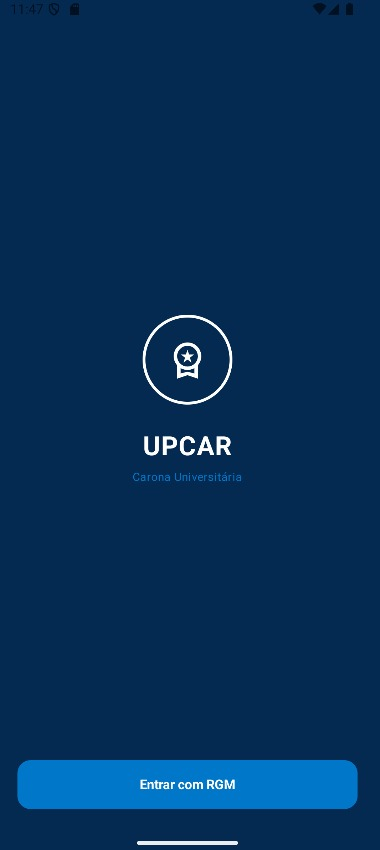
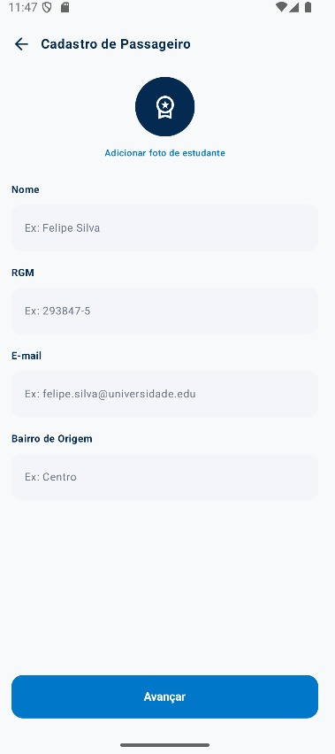
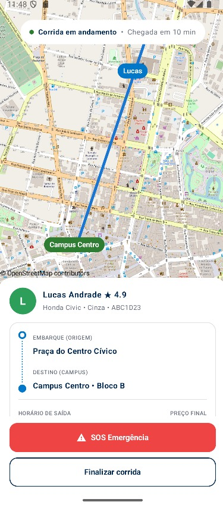
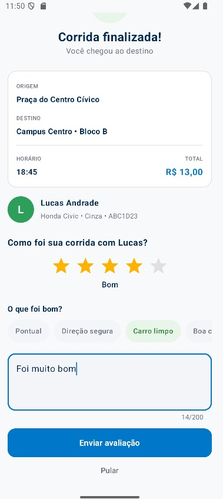
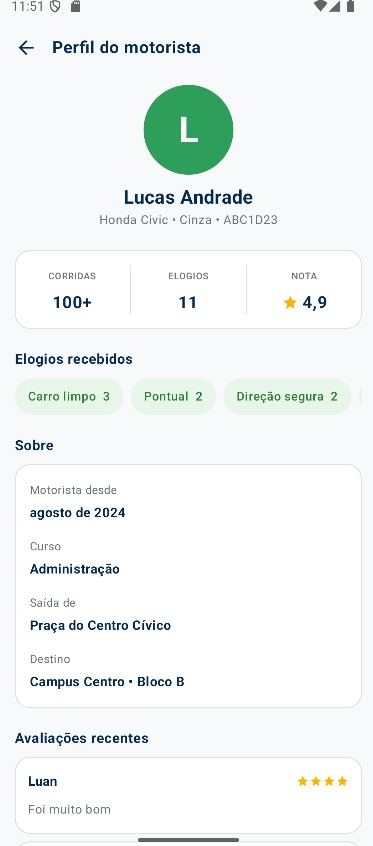

# UpCar

O **UpCar** é um aplicativo Android desenvolvido em Kotlin que simula a experiência de solicitar e acompanhar uma carona até um campus universitário. O projeto reúne cadastro de passageiro, consulta de motoristas, solicitação de carona, negociação simulada, acompanhamento da corrida e avaliação.

## Telas do aplicativo

### 1. Tela inicial

A tela de boas-vindas apresenta a identidade visual do UpCar e permite iniciar o fluxo de cadastro do passageiro.



### 2. Cadastro de passageiro

O passageiro informa nome, RGM, e-mail e bairro de origem antes de avançar no aplicativo.



### 3. Corrida em andamento

Durante a corrida, o aplicativo exibe um mapa, os dados do motorista, origem, destino e opções para finalizar a corrida ou acionar a opção de emergência. O progresso apresentado é simulado.



### 4. Corrida finalizada e avaliação

Ao chegar ao destino, o passageiro visualiza o resumo da corrida e pode atribuir uma nota, selecionar elogios e escrever um comentário.



### 5. Perfil do motorista

O perfil apresenta informações do motorista, estatísticas, elogios e avaliações. Parte dos dados exibidos no perfil é ilustrativa, conforme a implementação atual do projeto.



## Funcionalidades

- **Cadastro de passageiro:** registro de informações pessoais e bairro de origem.
- **Lista de motoristas:** visualização de opções com veículo, placa, horário, preço e avaliação.
- **Solicitação de carona:** criação de uma solicitação associada ao motorista escolhido.
- **Chat e negociação:** envio de mensagens, contraproposta e confirmação simulada de valor.
- **Mapas:** visualização de motoristas e acompanhamento visual da corrida.
- **Acompanhamento da corrida:** progresso simulado até a finalização.
- **Perfil do motorista:** consulta das informações e do histórico apresentado no aplicativo.
- **Avaliação:** atribuição de nota, comentário e elogios após a corrida.
- **Persistência local:** armazenamento de passageiros, motoristas, caronas, mensagens e avaliações usando Room.

> **Importante:** a negociação e o deslocamento são simulados. O projeto não representa um serviço de transporte conectado a motoristas reais nem oferece localização em tempo real. Algumas informações do perfil do motorista são ilustrativas.

## Como funciona

1. **Boas-vindas:** o usuário inicia o fluxo no aplicativo.
2. **Cadastro:** informa os dados do passageiro.
3. **Escolha do motorista:** consulta a lista e seleciona uma opção de carona.
4. **Solicitação e chat:** a carona é criada e uma conversa é associada a ela. O passageiro pode enviar mensagens e sugerir outro valor.
5. **Confirmação:** a negociação é simulada e o passageiro pode confirmar a carona.
6. **Corrida em andamento:** o aplicativo mostra o mapa e simula o progresso da viagem.
7. **Finalização e avaliação:** o passageiro conclui o fluxo e pode avaliar a experiência.

## Tecnologias utilizadas

- **Kotlin** — linguagem principal.
- **Android SDK** — plataforma do aplicativo.
- **Jetpack Compose e Material 3** — construção da interface.
- **Navigation Compose** — navegação entre telas.
- **ViewModel, StateFlow e Coroutines** — gerenciamento de estado e operações assíncronas.
- **Room (com Flow)** — persistência local sobre SQLite, com consultas reativas.
- **OSMDroid** — componentes de mapa.
- **Gradle Kotlin DSL** — configuração e compilação do projeto.

## Estrutura do projeto

O código está em `app/src/main/java/com/example/upcar/`, organizado em camadas (arquitetura MVVM):

```text
upcar/
├── MainActivity.kt            Ponto de entrada: monta o banco, os Repositories e a Factory
├── ui/                        Camada de interface (somente @Composable)
│   ├── navegacao/             Rotas e fluxo de navegação
│   ├── telas/                 Uma tela por arquivo
│   ├── componentes/           Peças reutilizáveis (barra, avatar, mapas)
│   └── theme/                 Cores, tipografia e tema
├── viewmodel/                 ViewModels, UiStates e Factory
├── data/                      Entities, DAOs e banco Room
│   └── repository/            Repositories (única fonte de verdade dos dados)
└── util/                      Constantes, validações, formatadores e leitura de imagem
```

| Arquivo | Responsabilidade |
| --- | --- |
| `ui/navegacao/AppNavigation.kt` | Rotas, criação dos ViewModels (via Factory) e fluxo de navegação. |
| `ui/telas/BoasVindas.kt` | Tela inicial. |
| `ui/telas/CadastroPassageiro.kt` | Cadastro do passageiro. |
| `ui/telas/ProcuraMotorista.kt` | Listagem e seleção de motoristas. |
| `ui/telas/PerfilMotorista.kt` | Tela de perfil do motorista. |
| `ui/telas/Chat.kt` | Mensagens e negociação simulada. |
| `ui/telas/CorridaEmAndamento.kt` | Acompanhamento da corrida. |
| `ui/telas/CorridaFinalizada.kt` | Resumo e avaliação da corrida. |
| `ui/telas/CaronaConfirmada.kt` | Tela de carona confirmada (sem rota na navegação atual). |
| `ui/componentes/` | `ComponentesComuns.kt`, `MapaMotoristas.kt` e `MapaCorrida.kt`. |
| `viewmodel/MotoristaViewModel.kt` | Lista, busca, seleção, cadastro e remoção de motoristas. |
| `viewmodel/CaronaViewModel.kt` | Caronas, chat, contraproposta, corrida simulada e avaliação. |
| `viewmodel/PassageiroViewModel.kt` | Cadastro do passageiro (campos do formulário, validação e foto). |
| `viewmodel/ViewModelFactory.kt` | Entrega os Repositories a cada ViewModel. |
| `data/Modelos.kt` | Entities do Room. |
| `data/Daos.kt` | DAOs (leituras retornam `Flow`). |
| `data/AppDatabase.kt` | Banco Room e conversores. |
| `data/Dados.kt` | Motoristas iniciais. |
| `data/repository/` | Um Repository por Entity. |
| `util/` | `Constantes.kt`, `Validacoes.kt`, `Formatadores.kt` e `Imagens.kt`. |

## Como executar

### Pré-requisitos

- Android Studio compatível com a configuração do projeto.
- JDK compatível com a versão do Android Gradle Plugin.
- Android SDK exigido pelo projeto.
- Emulador Android ou dispositivo físico.

### Passos

1. Clone o repositório:

   ```bash
   git clone https://github.com/LuanNeuwirthC/upcar3.git
   ```

2. Acesse a pasta do projeto:

   ```bash
   cd upcar3
   ```

3. Abra o projeto no Android Studio e aguarde a sincronização do Gradle.
4. Instale as versões do Android SDK solicitadas, caso necessário.
5. Selecione um emulador ou dispositivo Android e execute a configuração `app`.

Para compilar pelo terminal no Windows:

```powershell
.\gradlew.bat assembleDebug
```

No Linux ou macOS:

```bash
./gradlew assembleDebug
```

## Trabalho 4: Arquitetura MVVM

Esta seção documenta a refatoração do projeto para MVVM. Nenhuma tela, campo ou funcionalidade foi criada: o app continua fazendo o que fazia no Trabalho 3 (adicionar, listar, atualizar, remover e persistir).

> PREENCHER: adicionar aqui os prints e o vídeo curto do app funcionando (ou o link do Google Slides).

### Como estava no Trabalho 3 e o que mudou

Todos os arquivos ficavam no mesmo pacote. Um único `CaronaViewModel` falava direto com os cinco DAOs, carregava os dados uma vez no `init` e mantinha o estado em listas e mapas do Compose (`mutableStateListOf`, `mutableStateMapOf`), que as telas liam e modificavam diretamente. Cada inserção ou remoção precisava ser repetida à mão na lista em memória e no banco.

Agora o fluxo é em camadas: **tela (ui) → ViewModel → Repository → DAO → Room**. A tela só observa o `uiState` e chama métodos do ViewModel; só o Repository fala com o DAO; e as consultas do DAO retornam `Flow`, então o Room avisa sozinho quando a tabela muda e a lista na tela se atualiza sem buscar de novo.

### Divisão dos pacotes

| Pacote | O que foi para lá |
| --- | --- |
| `ui` | Todos os `@Composable` (telas, componentes, navegação e tema), sem lógica de banco nem regra de negócio. |
| `data` | As `@Entity`, os `@Dao` e a classe `@Database`, como já existiam no Trabalho 3. |
| `data.repository` | Os cinco Repositories novos, um por Entity. |
| `viewmodel` | Os ViewModels, os `UiState` e a `ViewModelFactory`. |
| `util` | Constantes, validações, formatadores e leitura de imagem (funções sem estado). |

A `MainActivity` ficou na raiz do pacote para continuar valendo a referência `.MainActivity` do `AndroidManifest.xml`.

### Por que o Repository existe

Antes, o ViewModel dependia diretamente do Room. Agora, a tela nunca fala com o DAO, só o Repository fala, e só o ViewModel fala com o Repository. Se um dia os dados vierem de outro lugar (uma API, por exemplo), só o Repository muda; ViewModel e telas continuam intactos. Também é ele que concentra o acesso à foto escolhida na galeria (`PassageiroRepository`) e a carga inicial dos motoristas (`MotoristaRepository`).

### O que tem em cada UiState e por que

| UiState | Campos | Motivo |
| --- | --- | --- |
| `MotoristaUiState` | `motoristas`, `destinoBusca`, `selecionadoId` e a lista derivada `motoristasFiltrados` | É tudo o que a tela de motoristas precisa para desenhar a lista e o mapa: os dados, o texto da busca e o card selecionado. |
| `CaronaUiState` | `motoristas`, `caronas`, `mensagens`, `avaliacoes`, `progressoCorridas`, `corridasFinalizadas` | Chat, corrida em andamento, corrida finalizada e perfil leem as mesmas informações. Os motoristas vêm junto para que essas telas encontrem o motorista de cada carona. |
| `PassageiroUiState` | `passageiro`, campos do formulário (`nome`, `rgm`, `email`, `bairro`), `fotoUri`, `foto`, `tentouAvancar` e as mensagens de erro | Agrupa o texto do formulário, a foto já decodificada e as regras de validação, que saíram da tela. |

Ficaram como estado local da tela (`remember`) apenas coisas puramente visuais: diálogo aberto, rascunho da mensagem do chat, campos do formulário de nova carona e do formulário de avaliação.

Cada ViewModel segue o padrão pedido: `_uiState` privado (`MutableStateFlow`) e `uiState` público (`StateFlow`), e as telas usam `collectAsStateWithLifecycle()`.

### Algo quebrou durante a reorganização? Como encontramos e corrigimos

Pontos tratados durante a refatoração:

- **Remoção de motorista:** o código antigo apagava as caronas da lista em memória antes de buscar quais caronas apagar no banco, então as caronas do motorista removido nunca eram apagadas do banco. Com a lista vindo do Room, elas reapareceriam na tela. Agora as caronas são lidas antes da remoção.
- **Abertura do chat:** como o Room responde de forma assíncrona, o chat poderia abrir antes de a carona aparecer no estado. Agora `solicitarCarona` só chama a navegação depois que a carona chega ao `uiState`.
- **Toque duplo:** com o estado vindo do banco, dois toques rápidos poderiam repetir uma ação (solicitar, contraproposta, confirmar, avaliar). O `CaronaViewModel` ignora a repetição enquanto a primeira ainda está em andamento.
- **Pré-visualizações:** as telas foram divididas em uma função que coleta o `uiState` e outra que apenas desenha, para os `@Preview` continuarem funcionando sem banco.

> PREENCHER: contar com as suas palavras se algo mais quebrou e como foi encontrado e corrigido.

### Dificuldades do trio

> PREENCHER: quem teve dificuldade em qual parte e como resolveram.

## Armazenamento de dados

O Room mantém dados localmente no dispositivo. As entidades persistidas incluem passageiros, motoristas, caronas, mensagens e avaliações. Os motoristas iniciais são inseridos quando o banco ainda não contém registros. Não foi identificado no fluxo analisado um backend remoto para sincronização entre dispositivos.

## Limitações atuais

- A negociação com o motorista é simulada.
- O progresso da corrida é simulado.
- Os dados são armazenados localmente, sem sincronização por servidor identificada.
- Algumas informações do perfil e avaliações demonstrativas são ilustrativas.
- A exibição de mapas depende da configuração de rede e dos serviços utilizados.

## Objetivo do projeto

O UpCar demonstra a construção de um fluxo de caronas em um aplicativo Android, combinando navegação entre telas, gerenciamento de estado, persistência local, mapas e interação simulada com o usuário.

---

Desenvolvido como projeto acadêmico realizado por:
Luan Henrique Neuwirth Castilho 
Lorenzo Vanelli
Murilo Opis
.
